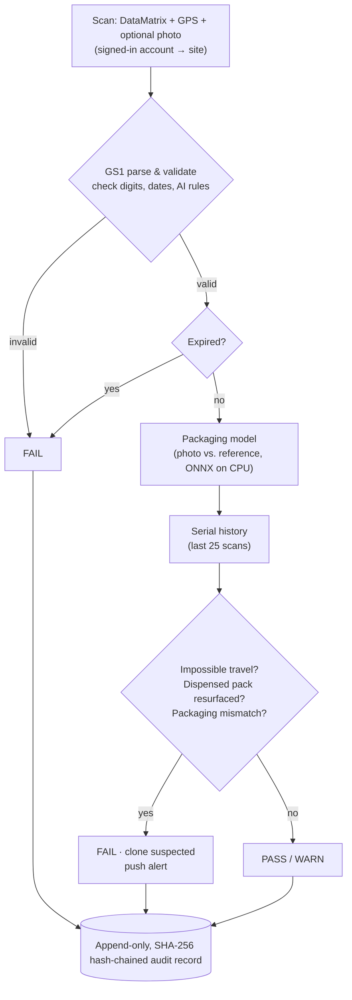
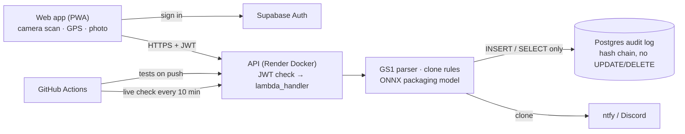

# MedTrace-ET

Smartphone verification of serialised medicines for Ethiopian pharmacies, health posts and distributors. A pharmacist scans the GS1 DataMatrix on a pack; MedTrace-ET validates the code, checks the serial's scan history for cloning, optionally compares a photo of the packaging with the manufacturer's reference, records the scan in a tamper-evident audit log, and alerts when a cloned code is intercepted.

| | |
|---|---|
| **Web app** | https://medtrace-app.onrender.com |
| **API** | https://medtrace-et.onrender.com/health · public `POST /parse` |
| **Live checks** | [Actions → Live check](https://github.com/kalebdida/MedTrace-ET/actions/workflows/live-check.yml) (every 10 minutes; full clone demo on demand) |
| **Tests** | [Actions → Test and deploy](https://github.com/kalebdida/MedTrace-ET/actions/workflows/ci-cd.yml) · [Frontend](https://github.com/kalebdida/MedTrace-ET/actions/workflows/frontend.yml) |

Demo accounts (`adama@medtrace.demo`, `dessie@medtrace.demo`, `inspector@medtrace.demo`) exist on the live system; ask the team for passwords. The public barcode checker on the sign-in page works without an account.

## Problem and users

Medicines in Ethiopia pass from manufacturers and importers through regional wholesalers to community pharmacies and rural health posts. EFDA's traceability mandate requires GS1 serialisation and EPCIS reporting, but small pharmacies and distributors have no affordable way to verify codes, and a valid serial copied onto counterfeit packaging passes any scanner that only reads the code.

- **Pharmacists and dispensers**: verify a pack in seconds before dispensing, on an ordinary Android phone, in English or Amharic.
- **Regional wholesalers and distributors**: log receive/ship/dispense events (EPCIS business steps) without industrial scanners.
- **EFDA inspectors**: look up any pack's history, see where a cloned serial travelled, and confirm the record has not been altered.

## How a scan is judged



**Deterministic rules where they are exact; machine learning where rules cannot see.** A serial in two cities faster than any vehicle can travel, or a pack dispensed twice, is caught by rules with no model needed. Those rules only fire when a *second* copy of a serial is scanned, though, and in our evaluation only about half of clones are caught before a counterfeit reaches a patient. A genuine serial printed on counterfeit packaging, scanned for the first time, can only be caught by looking at the packaging. That is why the packaging model exists.

## Where AI/ML is used

| Component | What it does | Evidence |
|---|---|---|
| **Packaging forensics** (`backend/visual_model`, `ml/packaging`) | Frozen ImageNet MobileNetV3-Small backbone plus a learned projection head, exported to ONNX (4 MB) and run on CPU inside the API. Compares a phone photo with the product's enrolled reference and returns a 0–1 similarity; below the calibrated threshold → `PACKAGING_MISMATCH` (critical, clone alert). | Held-out synthetic test set: **AUC 0.9999, 216/216 synthetic defects caught, 1/36 genuine captures falsely flagged**, 5 ms p50 CPU latency. The previous head on the same images reached AUC 0.947 and caught 73%. [Results](ml/packaging/results/README.md) · [comparison](ml/packaging/results/head_comparison.json) |
| **Routing anomaly model** (`ml/routing`) | Isolation Forest on each serial's movement features (`travel_features` stored with every scan). | Exported and evaluated, **not used in verdicts**: AUC 0.88, but it added 12 clone detections for 32 extra false alerts versus the rules. [Results](ml/routing/results/README.md) |
| **Clone rules evaluation** (`backend/evaluation`) | Synthetic Ethiopian supply chain (14 cities, 3,000 packs, 18.5k scans, faulty phone GPS, batches of clones) replayed through the production detector. | At the default 120 km/h: **91.7% of cloned serials caught, 0 of 2,687 genuine packs falsely flagged**; 52% caught before a counterfeit is dispensed. [Results](backend/evaluation/README.md) |

All model evidence is on **synthetic data**. No real counterfeit packaging or field scans were available, and the numbers describe the method under stated assumptions, not field accuracy. See [Limitations](#known-limitations).

## Architecture

The same backend code runs on two deployments, selected by environment variables.

| Layer | Live (free, no credit card) | AWS path (IaC in `infra/`) |
|---|---|---|
| Web app | Render static site (React PWA) | any static host |
| API | Render Docker web service, FastAPI → `lambda_handler` | API Gateway HTTP API + Lambda container image |
| Sign-in | Supabase Auth, JWT verified in `server.py` | Cognito + API Gateway JWT authorizer |
| Audit log | Supabase Postgres, INSERT/SELECT-only role + immutability trigger | DynamoDB, IAM PutItem/Query only |
| Alerts | ntfy.sh / Discord | SNS |
| Monitoring | `/metrics`, Render logs, Live check workflow | CloudWatch EMF metrics, alarms, dashboard, budget |
| Deploy | Render auto-deploy from `main`; GitHub Actions tests | GitHub Actions OIDC → SAM |



**Security.** No credentials in the repository. The site recorded for a scan comes from the signed-in account (`app_metadata.site_id`, editable only by administrators), not the request body. `/scan` and `/history` reject unsigned requests. The database role used by the API cannot update or delete audit rows, and a trigger blocks it even for the table owner. Every record stores the SHA-256 of its predecessor, so editing or deleting a record is detected by `/history`. Two simultaneous scans of the same serial cannot both pass unseen: the second write conflicts and is re-assessed with the first in its history.

Details: [backend/README.md](backend/README.md) (API, rules, audit design) · [docs/FREE_DEPLOY.md](docs/FREE_DEPLOY.md) (live deployment) · [infra/README.md](infra/README.md) (AWS) · [frontend/README.md](frontend/README.md) (app) · [ml/README.md](ml/README.md) (models, data, licences).

## Run it locally

```bash
# Backend tests (DynamoDB/SNS mocked; Postgres tests need Docker)
cd backend && python3 -m venv .venv && . .venv/bin/activate
pip install -r requirements-dev.txt && python -m pytest -q

# API server (/health and /parse work as is; /scan and /history need DATABASE_URL
# and a Supabase JWT, see docs/FREE_DEPLOY.md)
pip install -r requirements-server.txt && uvicorn server:api --port 7860

# Web app
cd ../frontend && npm ci && VITE_API_URL=http://localhost:7860 npm run dev

# Reproduce the evaluations
cd ../backend && python -m evaluation.simulate                    # clone rules
cd .. && python ml/packaging/scripts/make_demo_dataset.py && \
  python ml/packaging/retrain_head.py && python ml/packaging/evaluate.py   # packaging model
```

## Known limitations

- **Synthetic data only.** Packaging references are three fictional designs, and counterfeits are synthetic defects (colour shift, ink bleed, reprint, moved stamp, low resolution, halftone). Real deployment needs enrolled manufacturer references, real phone photos for calibration, and real counterfeit examples. Clean digital renders score lower than phone photos (domain shift).
- **First copy wins.** The rules cannot tell the first scan of a cloned serial from the genuine pack; only the packaging check can.
- **GPS comes from the phone.** The site is bound to the account, but coordinates could be spoofed by a compromised device.
- **Scanner separators.** If a scanner strips the GS/FNC1 separators, batch and serial can merge; the parser warns but cannot always split them.
- **Free hosting.** The API sleeps after 15 idle minutes (kept awake by the live check); Supabase pauses after a week without activity.
