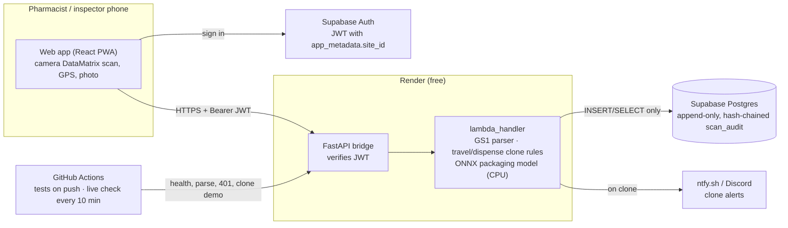

# Free deployment: Render + Supabase + GitHub Actions

The live system runs entirely on free plans with no credit card. The AWS path (Lambda container, DynamoDB, Cognito, SNS, CloudWatch) remains fully supported through [infra/README.md](../infra/README.md); the backend code is the same in both and picks its adapters from environment variables.

| Live component | URL |
|---|---|
| Web app (pharmacists, inspectors) | https://medtrace-app.onrender.com |
| API | https://medtrace-et.onrender.com (`/health`, `/parse`, `/scan`, `/history`, `/metrics`) |
| Live checks (every 10 min) | GitHub → Actions → **Live check** |

| AWS service | Free replacement | How the guarantee is kept |
|---|---|---|
| Lambda + API Gateway | **Render** web service running `backend/Dockerfile.server` (FastAPI bridge to the same `lambda_handler`) | Same routing, validation and verdict code |
| Cognito + JWT authorizer | **Supabase Auth**; `server.py` verifies each JWT (HS256 secret or RS256/ES256 via JWKS; issuer, audience, expiry) | Site comes from `app_metadata.site_id`, which users cannot edit |
| DynamoDB append-only log | **Supabase Postgres** `scan_audit` | App role has only INSERT/SELECT; a trigger rejects UPDATE/DELETE/TRUNCATE; same SHA-256 hash chain and `(pk, seq)` conflict detection |
| SNS | **ntfy.sh** push (and/or a Discord webhook) | Delivery failure never loses the scan; `alert_sent` reports it |
| CloudWatch metrics/alarms | `/metrics` counters + latency percentiles, Render logs (EMF JSON lines), **Live check** workflow (GitHub emails on failure) | |
| S3/ECR static hosting | **Render static site** for `/frontend` | |
| SAM + GitHub Actions deploy | Render auto-deploys `main`; **Test and deploy** runs the full test suite (with a Postgres service container) on every push | |
| Budget alarm | Not needed: no payment method is on file with any provider, so nothing can be billed. Free-plan limits are hard caps. | |

## Reproduce from scratch

### 1. Supabase (database and sign-in)

1. supabase.com → **New project** (free). Save the database password.
2. **SQL Editor** → paste [supabase/migrations/001_scan_audit.sql](../supabase/migrations/001_scan_audit.sql) → **Run**.
3. In SQL Editor, run `ALTER ROLE medtrace_app WITH PASSWORD '<new strong password>';` (do not commit it).
4. **Connect** (plug icon at the top) → *Transaction pooler*. Build `DATABASE_URL` as `postgresql://medtrace_app.<PROJECT_REF>:<password>@<pooler host>:6543/postgres`, using the host shown there.
5. **Project Settings → API keys**: copy the project URL (`SUPABASE_URL`) and the anon key (public; used by the web app). **JWT Keys**: if the project uses the legacy shared secret, copy it as `SUPABASE_JWT_SECRET`; for asymmetric keys nothing is needed (JWKS is fetched automatically).
6. Create pharmacy accounts with `app_metadata.site_id` set (`scripts/create-demo-users.py` with the service-role key on your own computer only, or Authentication → Users and then set `raw_app_meta_data` in SQL).

### 2. Render (API and web app)

1. render.com → **New → Web Service** → this repository, branch `main`, runtime **Docker**, Dockerfile `backend/Dockerfile.server`, Docker context `backend`, plan **Free**.
2. **Environment**: `DATABASE_URL`, `SUPABASE_URL`, `SUPABASE_JWT_SECRET` (legacy keys only), `REQUIRE_AUTH=true`, and optionally `NTFY_TOPIC_URL=https://ntfy.sh/<long-random-topic>` and/or `DISCORD_WEBHOOK_URL`.
3. **New → Static Site** → same repository, build command `cd frontend && npm ci && npm run build`, publish directory `frontend/dist`, env `VITE_API_URL=<the web service URL>` and `VITE_SUPABASE_URL`.
4. Both redeploy automatically on every push to `main`.

### 3. Keep it awake and monitored

Render's free web services sleep after 15 minutes without traffic. The **Live check** workflow (`.github/workflows/live-check.yml`) requests `/health` every 10 minutes, so the API stays warm, and on each run checks `/health`, public `/parse`, that `/scan` rejects unsigned requests (401) and that the web app responds. A failure emails the repository owner. Scheduled workflows run from the repository's **default branch**, which must contain this file.

Manual runs (Actions → Live check → Run workflow) accept two pharmacy accounts and run the full clone demo against production: an Adama scan must PASS, the same serial in Dessie 50 minutes later must FAIL with `IMPOSSIBLE_TRAVEL`, and the audit chain must verify. Credentials are read from the event payload and masked, never printed.

### 4. Clone alerts

Subscribe to the ntfy topic in the ntfy app (Android/iOS) or at `https://ntfy.sh/<topic>`. Anyone who knows the topic name can read it, so use a long random name and never include patient data. A Discord webhook can be added in parallel.

## Limits of the free tier

- First request after a sleep takes about a minute (mitigated by the 10-minute live check).
- Supabase free projects pause after a week without activity; resume from the dashboard.
- `/metrics` counters are in memory and reset on each redeploy; durable history is the audit table and Render's log retention.
- Free plans and their limits can change.

## Architecture

