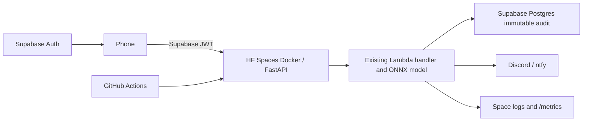

# Free deployment: Supabase + Hugging Face

Use the free Supabase plan and HF CPU Basic Space; do not select paid hardware. Free quotas and provider policies can change. The repository still supports AWS through infra/README.md. The synthetic packaging model's limitations are documented in ml/README.md.

## 1. Create Supabase and the database

1. Sign in at supabase.com/dashboard. Choose New project, a free organization, a project name and a strong database administrator password. Save that password securely and wait for provisioning.
2. In the project sidebar open SQL Editor → New query. Copy the complete contents of [001_scan_audit.sql](../supabase/migrations/001_scan_audit.sql), paste and Run. It is repeatable.
3. In another private SQL Editor query run `ALTER ROLE medtrace_app PASSWORD 'YOUR_NEW_STRONG_PASSWORD';` with a password you generate. Never commit this query or password. The app role only has INSERT/SELECT access. The trigger rejects UPDATE, DELETE and TRUNCATE even by the table owner; a database administrator can still change/drop the trigger, so protect administrator credentials.
4. Click Connect at the top of the project dashboard → Connection string → Session pooler. Copy the URI, use username `medtrace_app.PROJECT_REF` in place of `postgres.PROJECT_REF`, and replace the password with the app-role password (URL-encode special characters). Keep the pooler hostname and database name shown by Supabase. Add `?sslmode=require` if there is no query string. This is DATABASE_URL. The shared pooler supports IPv4; avoid the IPv6-only direct URL if your Space cannot reach it. Use session mode, port 5432.
5. Project Settings → Data API: copy Project URL as SUPABASE_URL. Project Settings → API Keys → Legacy anon/service_role keys: copy anon as SUPABASE_ANON_KEY for the local demo. Copy service_role as SUPABASE_SERVICE_ROLE_KEY **on your own computer only**. It bypasses authorization; never put it in the Space, GitHub, browser app, or chat. If the dashboard separates API URL and keys, use the Connect dialog's App Framework/API section for the URL.
6. Project Settings → JWT Keys: if using the legacy shared JWT secret, reveal/copy it as SUPABASE_JWT_SECRET. For asymmetric signing keys, omit that secret: the server automatically verifies RS256/ES256 tokens using the project's `/auth/v1/.well-known/jwks.json`. SUPABASE_URL is required in either case; issuer, audience, expiration and signature are checked.
7. Authentication → Providers → Email: enable email/password sign-in. Demo users are admin-created and email-confirmed, so no email delivery is needed. Only trusted administrators set `app_metadata.site_id`; user_metadata is ignored.

## 2. Create Hugging Face Space

1. Sign in at huggingface.co → profile menu → New Space. Name it `medtrace`; choose Docker SDK, public visibility and free CPU Basic hardware. Record `YOUR_USERNAME/medtrace` as HF_SPACE_ID. An empty Space may show a build error until the first sync.
2. Space → Settings → Variables and secrets → New secret: add DATABASE_URL and SUPABASE_URL from step 1, and SUPABASE_JWT_SECRET only for legacy signing. Add REQUIRE_AUTH=`true` as a variable. Do not add AWS keys or the Supabase service-role key. The image enables the packaged visual model and its calibrated demo thresholds.
3. HF profile → Settings → Access Tokens → Create new token. Use a write token (or fine-grained write access to this Space). Copy it securely.
4. GitHub repository → Settings → Secrets and variables → Actions → Secrets → New repository secret: HF_TOKEN. On Variables → New repository variable: HF_SPACE_ID = `YOUR_USERNAME/medtrace`.

## 3. Enable clone alerts

1. Discord: open your private channel → Edit Channel → Integrations → Webhooks → New Webhook → Copy Webhook URL. Add it to HF Space secrets as DISCORD_WEBHOOK_URL.
2. Alternatively choose a long random topic name on ntfy.sh and set NTFY_TOPIC_URL=`https://ntfy.sh/YOUR_RANDOM_TOPIC` as a Space secret. Subscribe using the ntfy app or website. Public ntfy topics are not authenticated private storage: anyone knowing the topic can read/publish. Avoid sensitive patient data; Discord access should also be restricted.
3. Both may be set. The backend attempts both; alert_sent is false if either delivery fails. HTTP errors/timeouts never discard scans.

## 4. Deploy and check

1. Push to main, or GitHub → Actions → Test and deploy → Run workflow → main. Tests run before deployment. Without AWS_DEPLOY_ROLE_ARN, AWS deployment is skipped. Without HF_TOKEN/HF_SPACE_ID, HF deployment is skipped until configured.
2. Open the deploy-hf job. It uploads only server files and model artifacts, waits up to 20 minutes and checks health and barcode parsing. Check HF Space → Logs for build/runtime failures. Copy the direct `https://...hf.space` URL shown by the job as API_URL. Do not guess the subdomain for usernames containing hyphens.
3. Open API_URL/health. Confirm audit_log_configured, auth_required and visual_model_loaded are true. Health reports configuration, not a successful database query: the authenticated demo below verifies storage.
4. Open API_URL/metrics for aggregate counters and rolling latency percentiles. Metrics reset on restart and retain the latest 10,000 latencies. One uvicorn worker keeps a single counter set. EMF JSON remains in Space logs; no patient details are returned by /metrics.

## 5. Create users and demonstrate

On your computer install Python and run `pip install httpx==0.28.1`. In a terminal set SUPABASE_URL, SUPABASE_SERVICE_ROLE_KEY, ADAMA_PASSWORD and DESSIE_PASSWORD as environment variables using your shell's secure workflow. Choose passwords satisfying the project's policy. Never paste credentials into GitHub files or enable shell tracing.

Run `python scripts/create-demo-users.py` from the repository root. It creates `pharmacist-adama@medtrace.example` and `pharmacist-dessie@medtrace.example` with administrative site metadata. Existing users cause a clear error; inspect them in Supabase Authentication → Users rather than silently changing accounts. Remove the service-role key from your shell after this operation.

Set API_URL, SUPABASE_URL, SUPABASE_ANON_KEY and both passwords, then run `bash scripts/run-demo.sh` (Windows: Git Bash or WSL). It signs in both accounts, sends Adama then Dessie scans under a new serial, and prints verdict, flags, alert_sent and chain.valid. The timestamps are 50 minutes apart ending now. Expect the Dessie scan to flag IMPOSSIBLE_TRAVEL and the two-record chain to verify.

## 6. Before the demo and cleanup

Free CPU Spaces normally sleep after 48 hours of inactivity; policies may change. Open /health before demoing and wait for wake-up. Supabase free projects can also pause after inactivity: resume through its dashboard when needed. Keep an eye on free quotas. Space disk is ephemeral; audit records persist in Supabase. To retire the demo, delete the Space and Supabase project after exporting any audit records you need; revoke the HF token and remove GitHub secrets.

## Architecture

| AWS path | Free deployment replacement |
|---|---|
| Lambda + API Gateway | HF Spaces Docker + FastAPI |
| DynamoDB | Supabase Postgres with immutable trigger |
| Cognito | Supabase Auth |
| SNS | Discord webhook / ntfy |
| CloudWatch | /metrics + Space logs |
| SAM | Dockerfile + GitHub Actions + SQL migrations |

## Local tests

Install backend/requirements-dev.txt and backend/requirements-server.txt plus testcontainers==4.10.0. Run `cd backend && python -m pytest -q`. PostgreSQL tests use TEST_DATABASE_URL when supplied; otherwise they attempt a Docker PostgreSQL 16 container and skip if Docker/image startup is unavailable. CI supplies a real PostgreSQL service and must pass those tests. Use an isolated disposable test database: migration tests create a role/table/trigger. AWS-specific dependencies and tests remain intact.
