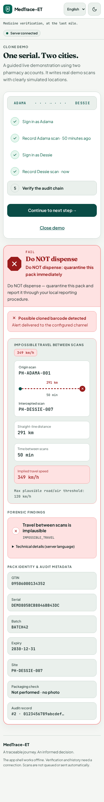
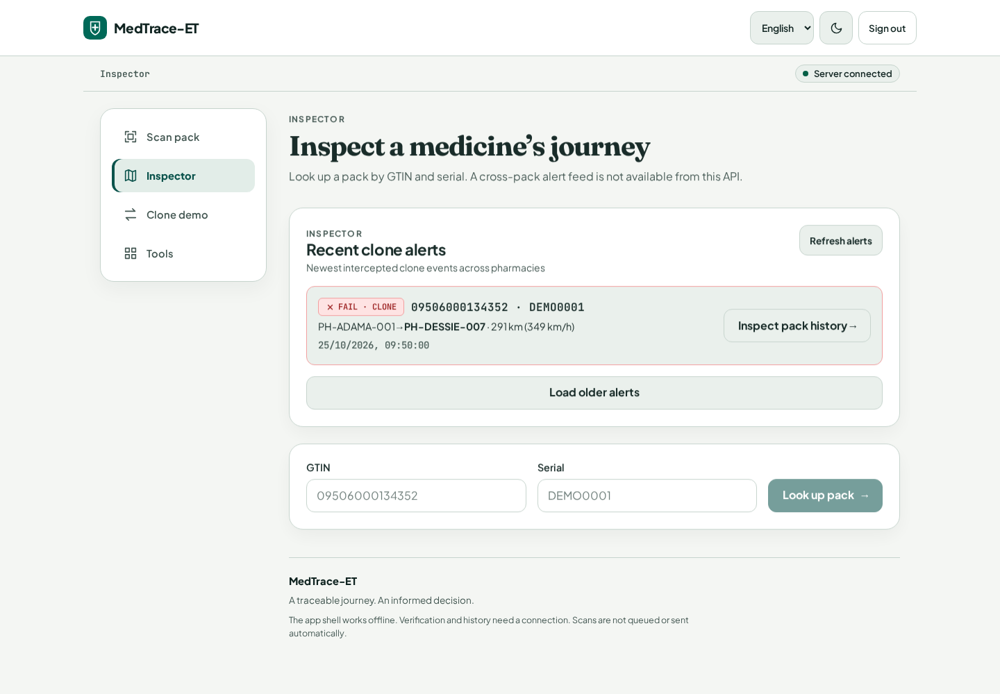

# MedTrace-ET frontend

Clinical-security medicine verification and inspector forensics interface for Ethiopian pharmacies (`Vite + React + TypeScript`). Render hosts the static site at https://medtrace-app.onrender.com; the configured API is https://medtrace-et.onrender.com.

## Features

- **Clinical-security visual system & responsive layout**: Designed as a medical-grade forensic scanner with deep teal/ink primary surfaces, warm off-white clinical cards, an 8px spacing scale, large touch targets (`>= 48px`), and WCAG AA contrast in both light and dark themes. Uses a bottom tab bar on phones (`< 1024px`) and a sticky side navigation rail on desktop (`>= 1024px`).
- **Typography & Bilingual i18n (English + Amharic)**: Pair of `Fraunces` (display), `Plus Jakarta Sans` (UI), `JetBrains Mono` (tabular GTIN/serial/hash data), and `Noto Sans Ethiopic` across both UI and monospace contexts so Amharic renders cleanly everywhere without missing-glyph tofu boxes. All application copy lives in `src/translations.ts`. Language and theme preferences persist locally.
- **Full-bleed Verdict Hero & Impossible Journey Telemetry**:
  - Colour-blind safe verdicts pair colour with distinct icon, badge shape, and explicit action copy: **PASS** (green circle `✓`, `"Checks passed"`), **WARN** (amber rounded diamond `!`, `"Check before dispensing"`), and **FAIL** (red octagon `✕`, `"Do NOT dispense"`).
  - Honesty rules are strictly preserved: PASS means the performed checks passed (not proof of authenticity), and clone alerts state delivery to the configured channel (never claiming delivery to EFDA).
  - When a clone / impossible-travel flag is present, the verdict screen renders a visual **Impossible travel between scans** card (`Origin site → Intercepted site`, straight-line distance in `km`, time apart in `min`, and implied speed in `km/h` compared against the plausible road/air threshold).
- **Inspector Alerts Dashboard (`GET /alerts`) & Animated History Map**:
  - Inspector accounts (`inspector@medtrace.demo`, no assigned site) open the inspector workspace featuring the **Recent clone alerts** dashboard (`GET /alerts`, newest first, paginated with `before`) alongside GTIN + serial lookup (`/history`).
  - Clicking **Inspect pack history** on any alert loads that pack's full audit chain, timeline, and map. If `GET /alerts` returns `403` or `501`, a clear status banner explains why the feed is unavailable while keeping GTIN + serial lookup ready.
  - History view displays a prominent **Audit chain intact ✓ / Audit chain TAMPERED ✕** cryptographic seal and an on-demand Leaflet map where impossible clone hops animate as a red dashed trajectory line between cities.
- **Procedural Three.js Medicine Pack Hero & Micro-interactions**:
  - Landing / sign-in hero features a procedural Three.js scene (`src/MedicineScene.tsx`) of a serialized medicine carton (`AMOXICILLIN 500mg`) with a 14×14 GS1 DataMatrix on its front face swept by a scanning laser line and framed by 3D reticle brackets. On an 8.4s loop, the pack flips between a **genuine** state (teal glow, `✓`) and a **clone detected** state (red pulse, `✕`).
  - Lazy-loaded via dynamic `import()` so it never blocks first paint, capped at `<= 30 fps`, paused via `IntersectionObserver` when off-screen or via `visibilitychange` when the tab is hidden, and automatically falls back to a static clinical SVG on low-end devices (`navigator.hardwareConcurrency <= 4` or `deviceMemory <= 2`), when offline, without WebGL, or with `prefers-reduced-motion: reduce`.
  - Includes animated verdict reveal (`<= 300 ms`), camera viewfinder corner brackets with a sweeping laser line, skeleton loading shimmers, and an animated waking-server status chip—all respecting `prefers-reduced-motion`.
- **ZXing DataMatrix camera scanner & Guided Clone Walkthrough**:
  - Rear-camera preference, supported-device torch toggle, successful-scan haptic feedback, cleanup on close, and immediate typed-code fallback when camera permissions are denied.
  - Guided live clone walkthrough (`src/DemoPage.tsx`) uses an isolated, non-persistent Supabase client so the pharmacist's normal session is never replaced, clearing demo passwords from memory after sign-in.

## Local setup

Use Node 22 (`.nvmrc`):

```sh
cd frontend
npm ci
npm run dev
```

Copy `.env.example` to `.env` if using another deployment. Vite values are public and embedded at build time:

| Variable                 | Purpose                                                               |
| ------------------------ | --------------------------------------------------------------------- |
| `VITE_API_URL`           | API origin; defaults to the live Render API                           |
| `VITE_SUPABASE_URL`      | Supabase project URL                                                  |
| `VITE_SUPABASE_ANON_KEY` | Public anon key; the existing project default remains in `src/api.ts` |

Never place service-role keys, JWT signing secrets or account passwords in Vite variables. `.env*` files are ignored except `.env.example`.

## Checks

```sh
npm run lint             # ESLint, TypeScript rules and React hook rules
npm run format:check     # Prettier
npm test                 # Vitest + Testing Library (19 unit & component tests)
npm run build            # strict TypeScript + production Vite build
npm run bundle:sizes     # reports raw and gzip sizes for every emitted asset
npx playwright install chromium
npm run test:e2e          # runs 5 Playwright E2E + axe WCAG 2.1 AA tests and captures screenshots
```

If Chromium is preinstalled, set `PLAYWRIGHT_CHROMIUM_EXECUTABLE=/usr/bin/chromium` instead of downloading a browser.

To check the production offline shell:

```sh
npm run build
npm run preview -- --port 5174
# In another terminal:
npm run test:offline
```

This verifies an offline reload and confirms that no heavy optional chunks (`Scanner`, `CloneMap`, `MedicineScene`, `bwip-js`) load on initial page paint.

## Live verification

Start the local app, supply `ADAMA_PASSWORD` and `DESSIE_PASSWORD` through your shell's environment (never commit passwords), then run:

```sh
npm run test:live
```

Optionally set `FRONTEND_URL` to the deployed frontend. This opt-in check writes two real demo scans, verifies `Adama PASS → Dessie FAIL → intact two-record history`, and prints only those outcomes.

## Bundle measurements

Minified production output reported by `npm run build` and `node scripts/bundle-sizes.mjs`. The initial JS bundle remains well below the `150 kB` gzip performance budget (`89.72 kB` gzip), while `three`, `leaflet`, `@zxing/browser`, and `bwip-js` remain lazy-loaded on demand.

| Asset                                 | Before (unsplit) | Previous pass | Current redesign | Current gzip |
| ------------------------------------- | ---------------: | ------------: | ---------------: | -----------: |
| Entry JavaScript (`index-*.js`)       |      1,695.12 kB |     279.19 kB |        293.87 kB | **89.72 kB** |
| Initial CSS (`index-*.css`)           |         19.18 kB |      13.52 kB |         25.59 kB |  **5.90 kB** |
| `HistoryPage-*.js` (lazy)             |                — |       3.64 kB |          8.86 kB |      2.96 kB |
| `DemoPage-*.js` (lazy)                |                — |       5.34 kB |          5.35 kB |      2.12 kB |
| `ToolsPage-*.js` (lazy)               |                — |       2.45 kB |          2.45 kB |      1.04 kB |
| `CloneMap-*.js` + CSS (lazy, Leaflet) |                — |     150.68 kB |        152.10 kB |     44.61 kB |
| `Scanner-*.js` (lazy, ZXing)          |                — |     412.78 kB |        413.00 kB |    108.34 kB |
| `MedicineScene-*.js` (lazy, Three.js) |                — |     521.71 kB |        535.71 kB |    135.45 kB |
| `bwip-js-*.js` (lazy, GS1 generator)  |                — |     869.06 kB |        869.06 kB |    241.66 kB |

## Screenshots

Generated by Playwright (`npm run test:e2e`) against deterministic fixtures in `e2e/flows.spec.ts`.

### Desktop Sign-in & 3D GS1 DataMatrix Scanner Hero


### Mobile Amharic (`Noto Sans Ethiopic`) & Dark Theme

| Amharic mobile (Light)                                        | Amharic mobile (Dark)                                   |
| ------------------------------------------------------------- | ------------------------------------------------------- |
|  |  |

### Verdict Hero Screens (PASS, FAIL & Impossible Journey) and Intact History

| PASS Verdict (`Checks passed`)                      | FAIL Verdict (`Do NOT dispense` + Impossible Journey) | Clone History & Animated Map                                           |
| --------------------------------------------------- | ----------------------------------------------------- | ---------------------------------------------------------------------- |
|  |    |  |

### Inspector Alerts Dashboard (`GET /alerts`) & Pack Audit Journey




## Render deployment

Keep the existing Render **Static Site** linked to `main`. Root directory: `frontend`; build command: `npm ci && npm run build`; publish directory: `dist`. Pushes to `main` auto-deploy.
