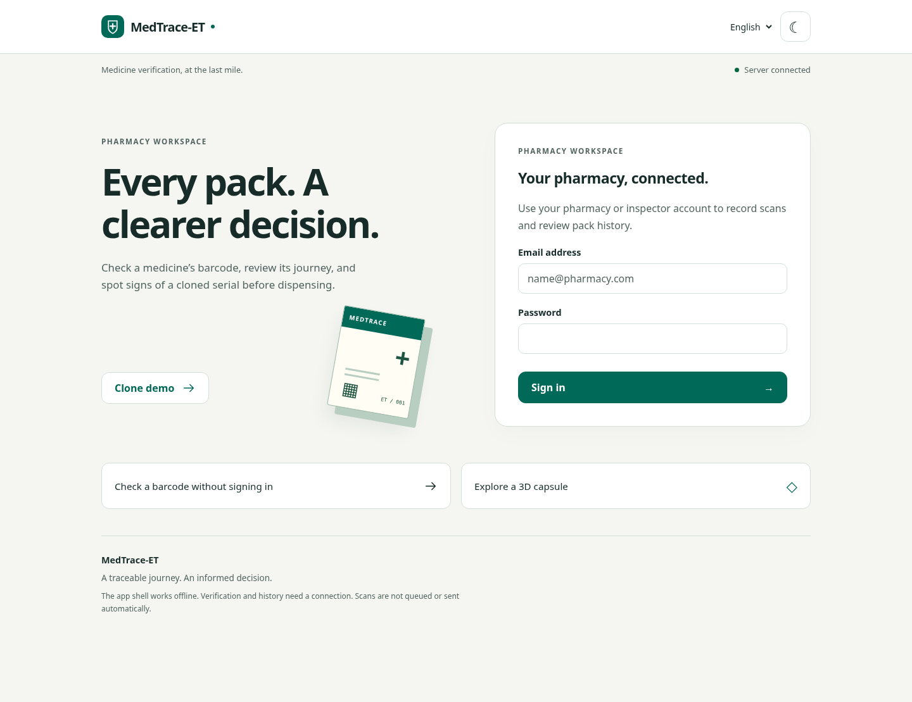
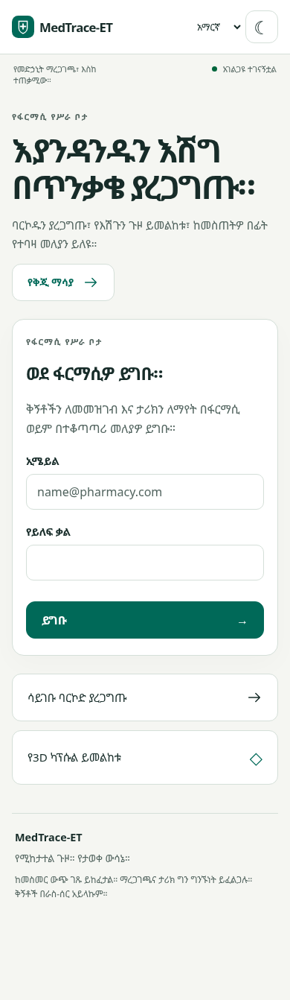
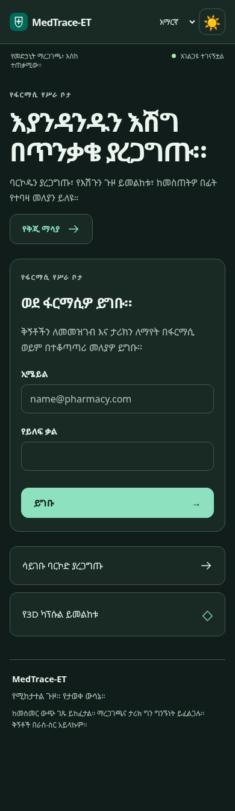
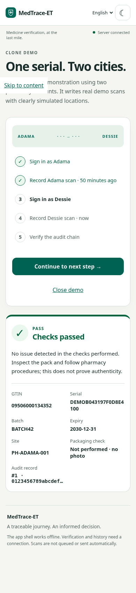
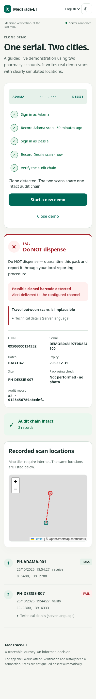
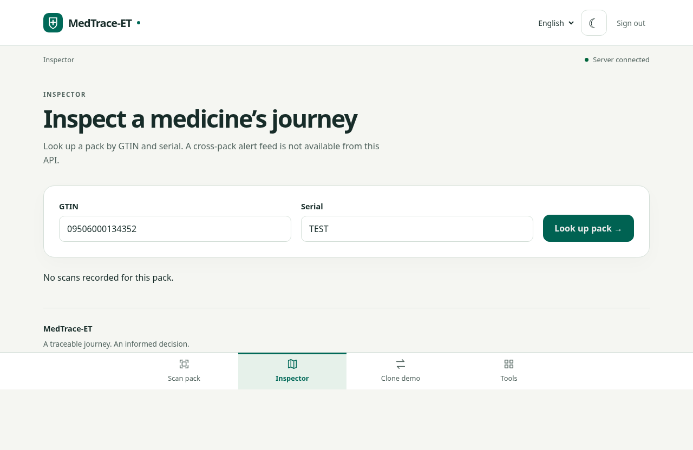

# MedTrace-ET frontend

The existing Vite + React + TypeScript app, enhanced for pharmacy verification and inspector lookups. Changes here do not require a new backend endpoint. Render hosts the static site at https://medtrace-app.onrender.com; the configured API is https://medtrace-et.onrender.com.

## Features

- Responsive, large-touch-target UI, explicit light/dark modes, visible keyboard focus, skip link, and distinct PASS/WARN/FAIL icons and guidance. PASS means the performed checks passed, not proof of authenticity. Alert delivery is described as delivery to the configured channel, not to EFDA.
- English and Amharic for sign-in, scanning, results, history, demo and controls. All application copy lives in `src/translations.ts`. Language and theme preferences persist locally. Backend-provided diagnostic text remains available in its original language under “Technical details”; new flag codes receive a generic translated prompt. Amharic clinical wording should receive a native-speaking pharmacist's review before field use.
- ZXing DataMatrix camera scanner with viewfinder, rear-camera preference, supported-device torch toggle, successful-scan haptic feedback, cleanup on close, and a typed-code fallback. Camera use requires HTTPS or localhost. Actual camera/torch hardware behavior still needs an Android-device check; browser tests cover denied permissions.
- Visible `⟨GS⟩` separators round-trip to ASCII 29. GPS locations and clearly labelled “Demo: pretend I’m in …” locations remain available. Optional photos are resized/compressed on-device; failure does not leave the page stuck in a busy state.
- Guided live clone demo with independent, non-persistent Supabase sign-in. Type the two passwords once; they remain only in component memory, are cleared after signing in to both demo accounts, and are discarded on exit. The normal pharmacy session is not replaced. Every run gets a new 20-character serial and two timestamps 50 minutes apart, ending at the run's start time. Each write requires a separate step. Lost scan responses are not automatically retried; use history recovery to check whether a write committed.
- Inspector accounts (no assigned site) open the lookup dashboard. GTIN+serial retrieves `/history`, with an intact/tampered chain result, timeline, coordinates and optional OpenStreetMap map. Popup text is inserted as text, never unsanitized HTML. No global clone-alert feed is invented.
- Background `/health` wake-up chip; free Render startup may take about 60 seconds. Requests time out after 90 seconds. Read-only requests and `/parse` may retry once; `/scan` never automatically retries.
- Installable PWA with local SVG branding, PNG icons, manifest and versioned service worker. After the first successful production load, the app shell works offline. API responses, tokens, passwords and third-party map tiles are never cached by the worker. Optional code is cached only after use. Verification/history still need connectivity; no offline writes or queue are implemented. Supabase's normal session storage is separate from the shell cache.
- Scanner, map, barcode generator and optional Three.js capsule load on demand. The capsule is illustrative, not diagnostic; it draws on resize/pointer movement rather than running an animation loop, respects reduced motion, and falls back if WebGL is unavailable. No web fonts or remote imagery are required by the first screen.

## Local setup

Use Node 22 (`.nvmrc`):

```sh
cd frontend
npm ci
npm run dev
```

Copy `.env.example` to `.env` if using another deployment. Vite values are public and embedded at build time:

| Variable                 | Purpose                                                               |
| ------------------------ | --------------------------------------------------------------------- |
| `VITE_API_URL`           | API origin; defaults to the live Render API                           |
| `VITE_SUPABASE_URL`      | Supabase project URL                                                  |
| `VITE_SUPABASE_ANON_KEY` | Public anon key; the existing project default remains in `src/api.ts` |

Never place service-role keys, JWT signing secrets or account passwords in Vite variables. `.env*` files are ignored except `.env.example`. Ordinary sign-in uses Supabase session persistence; use Sign out on shared devices.

## Checks

```sh
npm test                 # Vitest + Testing Library
npm run lint             # ESLint, TypeScript rules and React hook rules
npm run format:check     # Prettier
npm run build            # strict TypeScript + production Vite build
npx playwright install chromium
npm run test:e2e          # starts a local Vite server and captures screenshots
```

If Chromium is preinstalled, set `PLAYWRIGHT_CHROMIUM_EXECUTABLE=/usr/bin/chromium` instead of downloading a browser. Unit tests cover all three verdicts, truthful alert wording, token headers, 401, network/503 retries, ambiguous writes, GS separators, language persistence and demo sequencing/failure handling. Browser tests cover desktop/mobile layouts, English/Amharic, light/dark axe WCAG A/AA checks, camera denial, the entire guided demo and inspector lookup. Automated accessibility checks are evidence for those states, not a claim of a full WCAG audit.

To check the production offline shell:

```sh
npm run build
npm run preview -- --port 5174
# In another terminal:
npm run test:offline
```

This verifies an offline reload and that no scanner/map/3D/barcode-generator chunks load on the initial page. Optional features first opened offline show a recoverable loading error.

## Live verification

Start the local app, supply `ADAMA_PASSWORD` and `DESSIE_PASSWORD` through your shell's environment (do not save them in the repository), then run:

```sh
npm run test:live
```

Optionally set `FRONTEND_URL` to the deployed frontend. This is an opt-in test that writes two **real demo scans**, checks Adama PASS → Dessie FAIL → intact two-record history, and prints only those outcomes. It never records a trace, screenshot or credentials. Use `adama@medtrace.demo` and `dessie@medtrace.demo` for the guided UI; `inspector@medtrace.demo` is the lookup account.

During implementation, outbound requests to the live Render API were blocked by the execution environment's proxy (`403` / `ERR_TUNNEL_CONNECTION_FAILED`), before authentication. Therefore the live authenticated flow is **not yet verified**. Supplied passwords were not stored or committed. Local browser demonstrations below use fixture responses; they are not evidence of successful live writes. Allow the Render API and Supabase project domains in the execution environment, then rerun the live check.

## Bundle measurements

Minified production output, decimal kB, reported by `npm run build`. `npm run bundle:sizes` also reports actual UTF-8 byte sizes (279.19 kB for the entry, larger than the Vite display because of Amharic text) and gzip sizes. Initial entry includes React, Supabase, translations and the basic scan form. Optional chunks are excluded from initial loading and shell precaching.

| Asset                  |      Before | After (Vite report) |
| ---------------------- | ----------: | ------------------: |
| Entry JavaScript       | 1,695.12 kB |           274.49 kB |
| Entry JavaScript, gzip |   474.79 kB |            85.83 kB |
| Initial CSS            |    19.18 kB |            13.52 kB |
| Initial CSS, gzip      |     7.57 kB |             3.83 kB |

About **82% less gzipped entry JavaScript**. On-demand chunks: scanner 413 kB / 108 kB gzip; map 151 / 44 plus its CSS; Three.js capsule 522 / 131; printable barcode generator 869 / 242. Vite still warns about the two large optional chunks. Total downloadable code grows with the optional 3D view; this does not increase the initial route's JS load.

## Screenshots

Generated by Playwright against the local development server. Network responses use test fixtures and map tile downloads are blocked for deterministic tests; map markers/links still reflect fixture coordinates. The source tests live in `e2e/flows.spec.ts`.



| Amharic mobile                                                | Dark mobile                                             |
| ------------------------------------------------------------- | ------------------------------------------------------- |
|  |  |

| PASS step                                           | Clone and history                                                      |
| --------------------------------------------------- | ---------------------------------------------------------------------- |
|  |  |



## Render deployment

Keep the existing Render **Static Site** linked to `main`. Root directory: `frontend`; build command: `npm ci && npm run build`; publish directory: `dist`. Set public Vite variables in Render if overriding defaults. Pushes to `main` auto-deploy. The existing Frontend GitHub Actions workflow remains unchanged and runs `npm ci`, `npm test` and `npm run build`. The service worker updates on subsequent visits; close other app tabs and reopen to activate a waiting version. Browser application settings can unregister the worker during troubleshooting.

## Backend note

A recent-alert inspector dashboard would need an authenticated, inspector-authorized, paginated cross-pack alert endpoint with its access policy defined. None is documented today. Until then this frontend offers only the supported GTIN+serial lookup. An idempotency key on `/scan` would also be needed before safely enabling automatic write retries or offline scan replay.
