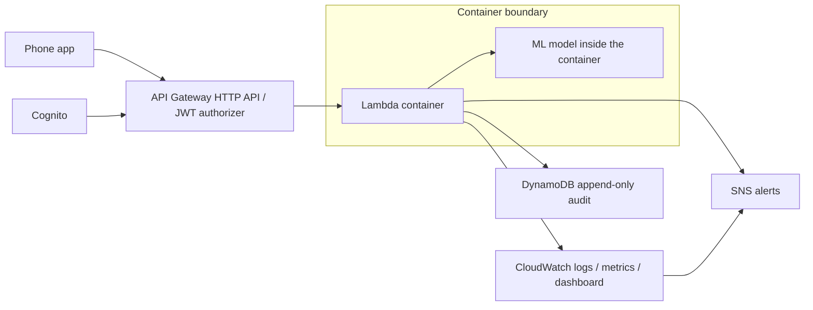

# Infrastructure operations

Use AWS CLI, SAM CLI, Docker, Python 3.13 and jq. Region is selected by AWS/SAM's region option (default `us-east-1` in samconfig), not a CloudFormation parameter that would misleadingly imply cross-region resource placement.

## One-time setup

With an administrator's short-lived AWS session, in the chosen region:

```sh
aws cloudformation deploy --template-file infra/bootstrap/github-oidc.yaml --stack-name medtrace-github-oidc --capabilities CAPABILITY_IAM --region us-east-1
aws cloudformation describe-stacks --stack-name medtrace-github-oidc --query 'Stacks[0].Outputs'
```

Add the returned role ARN as GitHub secret `AWS_DEPLOY_ROLE_ARN`. Set repository variables `BUDGET_EMAIL` (required), `ALERT_EMAIL` (optional), and optionally `AWS_REGION`. Confirm the SNS email subscription. If the account already owns the GitHub OIDC provider, import that resource into the bootstrap stack rather than creating a duplicate. No AWS access keys are used by CI.

Pushes to main test, lint, build, deploy and exercise the two public routes. Pull requests only test and lint. Bootstrap permissions cover the application and SAM-managed artifact resources; the bootstrap itself requires an authorized account administrator.

## Local deployment

```sh
cd infra
sam validate --lint
sam build
sam deploy --parameter-overrides "AlertEmail=$ALERT_EMAIL" "BudgetEmail=$BUDGET_EMAIL"
```

Use `--region` to override the default consistently for bootstrap, deploy and CLI commands. Outputs supply the endpoint, pool, client, table and topic. Health and parse are public; scan/history require a Cognito **ID token**. The packaging-model module and weights must be supplied by the ML team; this infrastructure does not manufacture a working model.

Export `USER_POOL_ID`, `USER_POOL_CLIENT_ID`, `ADAMA_PASSWORD`, and `DESSIE_PASSWORD` securely, then run `infra/scripts/create-demo-users.sh`. Passwords must satisfy Cognito's password policy. Follow its token instructions. Export `API_URL`, `ID_TOKEN` (Adama), and `DESSIE_ID_TOKEN`, then run `infra/scripts/demo-requests.sh`. A single pharmacy token cannot demonstrate two sites: the backend binds the site to its signed claims. The script uses the sample bodies with a fresh serial and timestamps 50 minutes apart ending now, avoiding future-clock clamping and old demo history.

## Security

The Lambda role has AWSLambdaBasicExecutionRole for logs, only PutItem and Query on its table, and Publish on its topic. It cannot update/delete audit records. Cognito clients can read custom:site_id but only administrators can write it. Only the exact main branch of this repository can assume the deployment role. The deployment role manages stack resources and can pass only application roles to Lambda; it has no AdministratorAccess. API creation and Cognito creation require broader resource scope; deployment credentials are privileged and main must be protected with review rules. Never run scripts with shell tracing enabled.

## Architecture



## Costs and observability

DynamoDB uses 5 RCU/5 WCU, below the traditional account-level 25/25 allowance, with no TTL. Lambda uses 512 MB and a 30-second maximum; small demo traffic can fit eligible request/compute allowances. HTTP API and Cognito allowances depend on account age and plan; SNS email deliveries and API requests also have limits. ECR image storage, SAM's S3 artifacts, CloudWatch custom metrics, alarms, dashboard and Logs Insights can incur charges. Four alarms and one dashboard are small, but EMF emits multiple custom metrics. Retention is 14 days and API throttling is 20 requests/second with burst 50. Throttling is not a spending cap. Monitor actual account usage and remove the demo promptly; zero cost cannot be guaranteed.

The monthly account-wide USD 5 budget emails at 80% actual and 100% forecast; it does not stop resources. CloudWatch alarms notify SNS for clones, alert failures, visual failures and Lambda errors. The dashboard includes volume, latency percentiles and clone locations. No separate AWS/Billing alarm is installed: AWS Budgets supplies the requested cost notifications.

## Teardown

Export TABLE_NAME from stack outputs. Disable table deletion protection before deletion (this permanently removes audit data):

```sh
aws dynamodb update-table --table-name "$TABLE_NAME" --no-deletion-protection-enabled
cd infra
sam delete --stack-name medtrace-et
```

Review SAM prompts for image/artifact cleanup. Remove the bootstrap stack separately when CI is retired; do not delete an OIDC provider shared by other projects. Budgets and dashboard are stack-managed. Check retained SAM artifact buckets/ECR repositories for leftovers and charges.
